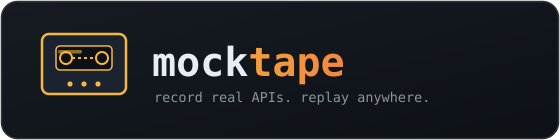
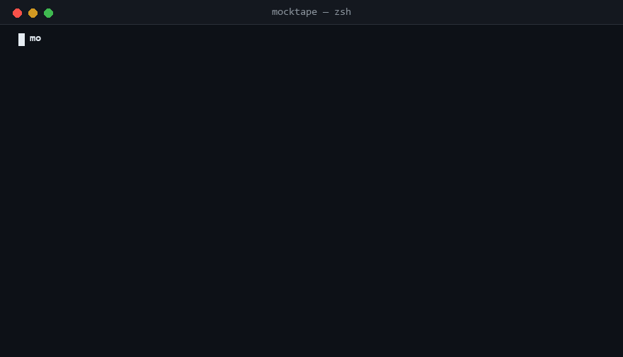
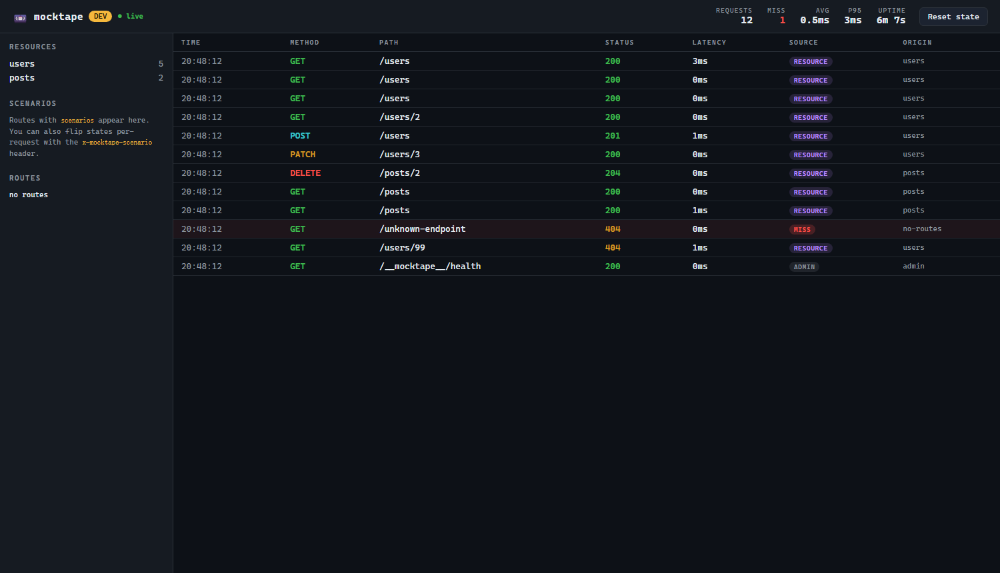
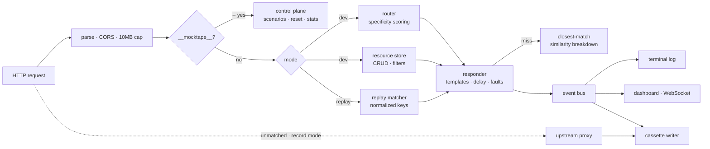

<div align="center">



**Mock APIs from a single file. Record real ones. Replay anywhere.**

[](https://github.com/EAnge1o/mocktape/actions/workflows/ci.yml)
[](https://www.npmjs.com/package/mocktape)
[](package.json)
[](src/index.ts)
[](vitest.config.ts)
[](LICENSE)

[Quick start](#quick-start) · [Record & replay](#record--replay) · [Dashboard](#the-dashboard) · [In tests](#in-tests) · [Why](#why-mocktape) · [中文文档](README.zh-CN.md)



*The live dashboard — every request, matched or not, with miss diagnostics:*



</div>

---

`mocktape` is a mock API server for frontend and integration testing. One config
file gives you a full CRUD API; a recording session captures any real API into a
replayable cassette; and everything runs on a tiny, dependency-light core built
directly on `node:http`.

```bash
npx mocktape init && npx mocktape dev
```

## Why mocktape

| | mocktape | json-server | Prism | WireMock |
| --- | --- | --- | --- | --- |
| CRUD API from one file | ✅ | ✅ | ➖ | ➖ |
| Record real APIs → replay offline | ✅ | ❌ | ❌ | ✅ (JVM) |
| Closest-match diagnostics on 404 | ✅ | ❌ | ❌ | partial |
| Scenario switching (header / API / UI) | ✅ | ❌ | ❌ | ✅ |
| Fault injection & latency | ✅ | ❌ | ✅ | ✅ |
| Live traffic dashboard | ✅ | ❌ | ✅ (paid) | ❌ |
| Library mode for test suites | ✅ | ❌ | ✅ | Java only |
| Runtime | Node 20+ | Node | Node/JVM | JVM |

json-server is archived and stops at CRUD. WireMock is powerful but lives on the
JVM. mocktape is the modern TypeScript middle ground: **stateful mocks, a tape
recorder, chaos engineering, and a dashboard — in one 75 kB npm package.**

## Quick start

```bash
npm i -D mocktape
mocktape init          # scaffolds mocktape.json
mocktape dev           # API on :3000 · dashboard on :3001
```

A full REST API now exists at `localhost:3000`:

```bash
curl "localhost:3000/users?role=admin&_sort=name"
curl -X POST localhost:3000/users -H 'content-type: application/json' \
  -d '{"name":"Ada"}'                        # → 201, auto-incremented id
curl -X DELETE localhost:3000/users/1        # → 204
```

Declarative routes with templates, conditions and named scenarios:

```yaml
routes:
  - name: payments
    method: POST
    path: /payments
    scenarios:
      default:  { status: 201, body: { id: "{{ $uuid }}", state: "approved" } }
      declined: { status: 402, body: { error: "card_declined" } }
```

```bash
curl -H 'x-mocktape-scenario: declined' -X POST localhost:3000/payments
```

Full reference: [docs/configuration.md](docs/configuration.md) ·
[scenarios & faults](docs/scenarios-and-faults.md)

## Record & replay

The tape is the point: capture a real API once, work offline forever.

```bash
mocktape record --upstream https://api.example.com   # proxy + record → cassettes/*.yaml
# …exercise the flows you need, Ctrl+C…

mocktape replay cassettes                            # identical responses, zero network
```

- Cassettes are **readable YAML** — volatile headers (`authorization`, `cookie`,
  `user-agent`, …) are never written, so they are safe to commit and review.
- Replay matching normalizes method, path, query order and body key order.
- **Misses are diagnostics**: a 404 includes the *closest recorded interaction*
  with a per-dimension breakdown (`method / path / query / body`) — API drift
  becomes obvious at a glance.
- `mocktape replay cassettes --update -u https://api.example.com` serves what
  matches and re-records misses — a rolling refresh.

Details: [docs/record-and-replay.md](docs/record-and-replay.md)

## The dashboard

Every request lands live on `http://localhost:3001`: method, status, latency,
and the source badge — `route`, `resource`, `replay`, `proxy`, or a red `MISS`.
Click any row for full headers and bodies; miss rows show the closest-match
breakdown. Scenario routes appear in a panel with dropdowns that flip responses
server-wide.

## Fault injection

Ship resilience code before production finds out you don't have it:

```json
{
  "path": "/inventory/:sku",
  "body": { "stock": 7 },
  "fault": { "type": "error", "rate": 0.3 }
}
```

`latency` · `error` · `garbage` · `reset` — with a probability `rate`, plus
global `latency: [50, 150]`. Fired faults add an `x-mocktape-fault` header so
assertions can tell injected chaos from real bugs.

## In tests

A real HTTP mock beats fetch-stubbing: no magic, no module mocks, just HTTP.

```ts
import { createMocktape } from "mocktape";

const tape = await createMocktape({
  config: { resources: { users: { seed: [{ id: 1, name: "Ada" }] } } },
});

await tape.fetch("/users/1");               // 200
tape.setScenario("payments", "declined");   // flip scenario state
await tape.close();
```

Also available: `mode: { type: "replay" }, tape: "cassettes/api.yaml"` for
cassette-backed integration tests, and a full
[admin API](docs/testing.md#admin-api-cheatsheet) under `/__mocktape__/*`
(`reset`, `scenarios`, `stats`, `recent`).

## CLI

```
mocktape dev [config]      serve mocks with hot reload
  -p, --port <n>           API port            --no-dashboard     disable UI
  --latency <min>-<max>    global latency      --silent           no logs

mocktape record -u <url>   proxy an upstream, record a cassette
  --out <dir> --name <f>   cassette location

mocktape replay [tape]     serve a cassette offline
  --update -u <url>        proxy & re-record misses

mocktape init              scaffold mocktape.json
```

Bare `mocktape` inside a project with a config file behaves like `mocktape dev`.

## Architecture



Engineering notes for the curious:

- **Zero-framework HTTP** — plain `node:http`; the whole runtime dependency
  list is 7 small packages (`commander`, `zod`, `yaml`, `chokidar`,
  `picocolors`, `ws`, `path-to-regexp`).
- **Specificity scoring** picks between overlapping routes (explicit method >
  wildcard, static segments > params, predicates add weight, config order
  breaks ties) — deterministic and fully unit-tested.
- **Replay normalization** fingerprints bodies with sorted-key JSON so
  whitespace and key order never break a match.
- Hot reload swaps the router atomically; in-memory CRUD state survives
  unrelated config edits.
- 82 tests (unit + integration incl. a full record→replay roundtrip), 85%+
  coverage with enforced thresholds, CI across Linux/macOS/Windows on Node
  20/22/24.

## Docs & examples

| Doc | What's in it |
| --- | --- |
| [Configuration reference](docs/configuration.md) | every field, matching rules, templates |
| [Record & replay](docs/record-and-replay.md) | cassettes, normalization, update mode |
| [Scenarios & faults](docs/scenarios-and-faults.md) | state switching, chaos engineering |
| [Testing](docs/testing.md) | library mode, admin API |

Runnable examples live in [`examples/`](examples): [CRUD](examples/01-crud),
[scenarios](examples/02-static-and-scenarios),
[record & replay](examples/03-record-replay),
[fault injection](examples/04-fault-injection).

## Roadmap

- [ ] OpenAPI import → routes, and response schema validation
- [ ] GraphQL & WebSocket mocking
- [ ] `mocktape diff` — compare live API against a cassette
- [ ] Proxy header rules & per-tenant cassettes
- [ ] Docker image & VS Code extension

## Sibling project: tapedeck

Same tape metaphor, different layer. [tapedeck](https://github.com/EAnge1o/tapedeck) is a
flight recorder for **LLM agents**: record every model/tool call of a run once (JSONL),
replay it offline forever for free, and diff two runs to find the first drifted step.
mocktape records **HTTP traffic** for frontend/integration tests; tapedeck records
**agent decisions** for regression testing LLM features. If the flows you mock end up
calling a model, use both.

## Contributing

PRs welcome — see [CONTRIBUTING.md](CONTRIBUTING.md). Bug reports with a minimal
config + failing request are especially appreciated. This project follows the
[Contributor Covenant](CODE_OF_CONDUCT.md); security issues go through
[SECURITY.md](SECURITY.md).

## License

[MIT](LICENSE) © Mocktape contributors
