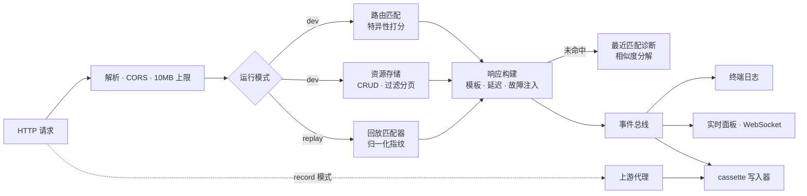

<div align="center">


**一个配置文件模拟整套 API。录制真实接口,随时随地离线回放。**

[](https://github.com/EAnge1o/mocktape/actions/workflows/ci.yml)
[](https://www.npmjs.com/package/mocktape)
[](package.json)
[](src/index.ts)
[](vitest.config.ts)
[](LICENSE)

[快速上手](#快速上手) · [录制与回放](#录制与回放) · [实时面板](#实时面板) · [测试集成](#测试集成) · [英文文档](README.md)

</div>

---


`mocktape` 是一个面向前端联调与集成测试的 Mock API 服务器。一个配置文件即可生成完整的
CRUD 接口;一次录制即可把任意真实 API 固化成可回放的"磁带";整个核心直接构建在
`node:http` 上,运行时依赖只有 7 个小包。

```bash
npx mocktape init && npx mocktape dev
```

## 它解决什么问题

- **前端被后端进度卡住** —— 写个 JSON 配置,秒起一套带状态、可增删改查的接口。
- **联调环境不稳定 / 内网不可达** —— `record` 把真实 API 录下来,飞机上也能开发。
- **集成测试依赖真实第三方** —— 回放磁带,CI 里零外部依赖,还能断言接口漂移。
- **弱网与故障场景没法学** —— 内置故障注入:延迟、500、脏数据、断连,按概率触发。

对比:`json-server` 已停更且只有 CRUD;WireMock 强大但要跑 JVM;Prism 偏校验。
mocktape 是 TypeScript 生态里的中间路线:**状态化 Mock + 录制回放 + 混沌工程 + 实时面板**。

## 快速上手

```bash
npm i -D mocktape
mocktape init          # 生成 mocktape.json
mocktape dev           # API 在 :3000 · 面板在 :3001
```

立刻拥有一套 REST API:

```bash
curl "localhost:3000/users?role=admin&_sort=name"   # 过滤 + 排序
curl -X POST localhost:3000/users \
  -H 'content-type: application/json' -d '{"name":"Ada"}'   # 201,自动 id
curl -X DELETE localhost:3000/users/1               # 204
```

声明式路由支持模板、条件匹配和命名场景:

```yaml
routes:
  - name: payments
    method: POST
    path: /payments
    scenarios:
      default:  { status: 201, body: { id: "{{ $uuid }}", state: "approved" } }
      declined: { status: 402, body: { error: "card_declined" } }
```

```bash
curl -H 'x-mocktape-scenario: declined' -X POST localhost:3000/payments
```

完整配置见 [docs/configuration.md](docs/configuration.md)(英文)。

## 录制与回放

这是 mocktape 的差异化能力:录制一次,离线 forever。

```bash
mocktape record --upstream https://api.example.com   # 代理 + 录制 → cassettes/*.yaml
# ……把需要的流量走一遍,Ctrl+C……

mocktape replay cassettes                            # 离线回放,响应一致
```

- 磁带是**可读的 YAML**:`authorization`、`cookie`、`user-agent` 等易变头永远不会写入,
  可以放心提交进仓库、放进 code review。
- 回放匹配做了归一化:方法、路径、query 顺序、body 键序都不会导致误判。
- **未命中即诊断**:404 响应会给出*最接近的已录制请求*及分维度相似度
  (`method / path / query / body`),接口漂移一眼定位。
- `mocktape replay cassettes --update -u <url>`:命中的直接回放,未命中的代理转发并重新
  录制——增量刷新磁带。

## 实时面板

每个请求实时出现在 `http://localhost:3001`:方法、状态码、耗时,以及来源徽标
—— `route`、`resource`、`replay`、`proxy`,未命中则是红色的 `MISS`。点击任意一行可查看
完整的请求/响应头与体;MISS 行会展示最近匹配的诊断详情。带场景的路由会出现在侧边栏,
下拉切换即全局生效。


## 故障注入

在用户之前发现你的超时、重试、熔断和骨架屏有没有写对:

```json
{
  "path": "/inventory/:sku",
  "body": { "stock": 7 },
  "fault": { "type": "error", "rate": 0.3 }
}
```

`latency`(延迟)· `error`(500)· `garbage`(脏数据)· `reset`(断连),配合概率
`rate` 和全局 `latency: [50, 150]` 使用。故障触发时会附加 `x-mocktape-fault` 响应头,
测试断言可以区分"注入的混沌"和"真 bug"。

## 测试集成

真 HTTP 服务比 fetch stub 更可信:没有模块 mock 的魔法,只有你的代码本来就要说的 HTTP。

```ts
import { createMocktape } from "mocktape";

const tape = await createMocktape({
  config: { resources: { users: { seed: [{ id: 1, name: "Ada" }] } } },
});

await tape.fetch("/users/1");               // 200
tape.setScenario("payments", "declined");   // 切换场景
await tape.close();
```

也支持在测试里回放磁带(`mode: { type: "replay" }`)。管理面 API 挂在
`/__mocktape__/*`:`reset`、`scenarios`、`stats`、`recent` 等,详见
[docs/testing.md](docs/testing.md)。

## 架构一览



给面试官/评审的工程亮点:

- **零框架**:直接用 `node:http` 写请求管道;运行时依赖仅 `commander` / `zod` / `yaml` /
  `chokidar` / `picocolors` / `ws` / `path-to-regexp` 七个小包。
- **路由匹配打分**:显式方法 > 通配、静态段 > 参数、条件加权、配置顺序兜底,确定性可测。
- **回放归一化**:对 body 做键排序指纹,空白与键序永远不影响命中。
- **热重载**:路由原子替换,资源内存状态在无关编辑后得以保留。
- **82 个测试**(单元 + 集成,含完整录制→回放往返),85%+ 覆盖率且有硬阈值,CI 覆盖
  Linux / macOS / Windows × Node 20 / 22 / 24。

## 文档与示例

| 文档 | 内容 |
| --- | --- |
| [配置参考](docs/configuration.md) | 全部字段、匹配规则、模板 |
| [录制与回放](docs/record-and-replay.md) | 磁带格式、归一化、update 模式 |
| [场景与故障](docs/scenarios-and-faults.md) | 状态切换、混沌工程 |
| [测试集成](docs/testing.md) | 库模式、管理面 API |

可运行示例见 [`examples/`](examples):[CRUD](examples/01-crud)、
[场景切换](examples/02-static-and-scenarios)、[录制回放](examples/03-record-replay)、
[故障注入](examples/04-fault-injection)。

## Roadmap

- [ ] OpenAPI 导入生成路由、响应 schema 校验
- [ ] GraphQL 与 WebSocket mock
- [ ] `mocktape diff` —— 对比真实 API 与磁带的漂移
- [ ] Docker 镜像与 VS Code 插件

## 姊妹项目：tapedeck

同样的磁带隐喻，不同的层次。[tapedeck](https://github.com/EAnge1o/tapedeck) 是给 **LLM Agent** 用的飞行记录仪：把一次运行里的每次模型/工具调用录成 JSONL，之后离线免费重放，并用 diff 找出第一个漂移的步骤。mocktape 录制 **HTTP 流量**服务前端/集成测试，tapedeck 录制 **agent 决策**服务 LLM 功能的回归测试——如果你 mock 的流程背后会调模型，两个一起用。

## 参与贡献

欢迎 PR,见 [CONTRIBUTING.md](CONTRIBUTING.md)。带最小配置 + 失败请求的 bug 报告最受欢迎。
安全问题请走 [SECURITY.md](SECURITY.md)。

## License

[MIT](LICENSE)
